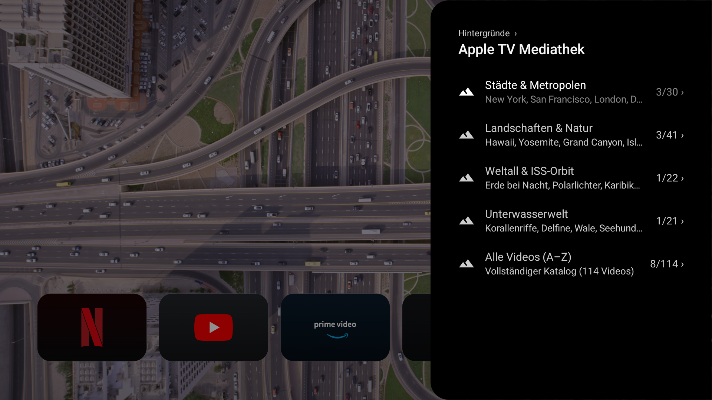

# Plume Launcher (Apple TV / tvOS Edition)

A custom, streamlined fork of [Plume Launcher](https://github.com/aradhyas8/Plume_Launcher) for Android TV and Google TV, reworked with a clean tvOS / Apple TV aesthetic and built-in 4K Aerial screensavers.

<p align="center">
  
</p>

---

## What’s different in this fork

Stock Android TV launchers are full of ads, sponsored carousels, and visual clutter. The goal of this fork was to take Plume's lightweight base and reshape it into a true Apple TV experience: minimalist dock, floating frosted glass controls, and seamless 4K video screensavers.

### Floating Control Center
* Replaces the stock Android TV quick settings with a floating frosted glass pill panel in the top-right corner.
* **Remote Battery Level**: Queries the TV remote's battery percentage directly over Bluetooth LE GATT (`0000180F` Battery Service) so you actually see the battery percentage (e.g. `88%`).
* **One-Click HDMI / PC Tile**: Instant shortcut to switch directly to your PC input (HDMI 1).
* **Network & Audio**: Fast toggles for Wi-Fi, Bluetooth, and audio output.
* **Smart Dock Movement**: The app dock smoothly pushes down when the control center opens so elements never overlap.

<p align="center">
  
</p>

### Apple TV 4K Aerials Library (114 Videos)
* Complete catalog of all official Apple TV Aerials sourced in full 4K SDR/HDR directly from Apple's CDN.
* Organized by category:
  * **Städte & Metropolen** (Dubai, London, New York, San Francisco, Hong Kong...)
  * **Landschaften & Natur** (Grand Canyon, Patagonia, Yosemite, Iceland, Greenland...)
  * **Weltall & ISS-Orbit** (Earth by Night, Auroras, Sahara, Caribbean...)
  * **Unterwasserwelt** (Coral Reefs, Sea Lions, Humpback Whales, Kelp Forests...)
* **Instant Snapshot Previews**: Every single aerial includes a bundled 16:9 preview thumbnail so you know what it looks like before hitting download.
* Background downloads with progress indication and local caching in internal storage.

<p align="center">
  
  
</p>

### tvOS Screensaver & Smooth Glass Menus
* When idle (or triggered via back button), the launcher smoothly transitions into a fullscreen video screensaver with clean location titles in the bottom-left corner.
* The settings sheet uses translucent graphite glass with rounded 24dp corners and subtle edge rims, keeping video playback visible in the background without glitchy black cutouts.

<p align="center">
  
</p>

---

## Installation

### Via ADB
1. Enable **Developer Options** and **USB / Network Debugging** on your Android TV.
2. Build or download `app-release.apk`.
3. Install and grant permissions:
```bash
adb connect <TV-IP>:5555
adb install -r -d -g app-release.apk
adb shell pm grant dev.plume android.permission.WRITE_SECURE_SETTINGS
adb shell pm grant dev.plume android.permission.BLUETOOTH_CONNECT
```

### Build from source
Requires JDK 17+ and the Android SDK.
```bash
git clone https://github.com/jigrdfsgrdgrd/Plume_Launcher.git
cd Plume_Launcher
./gradlew assembleRelease
```
The compiled APK will be at `app/build/outputs/apk/release/app-release.apk`.

---

## Credits
Based on the original [Plume Launcher](https://github.com/aradhyas8/Plume_Launcher) by aradhyas8. Aerial video streams and snapshots belong to Apple Inc.
Licensed under GPL-3.0.
